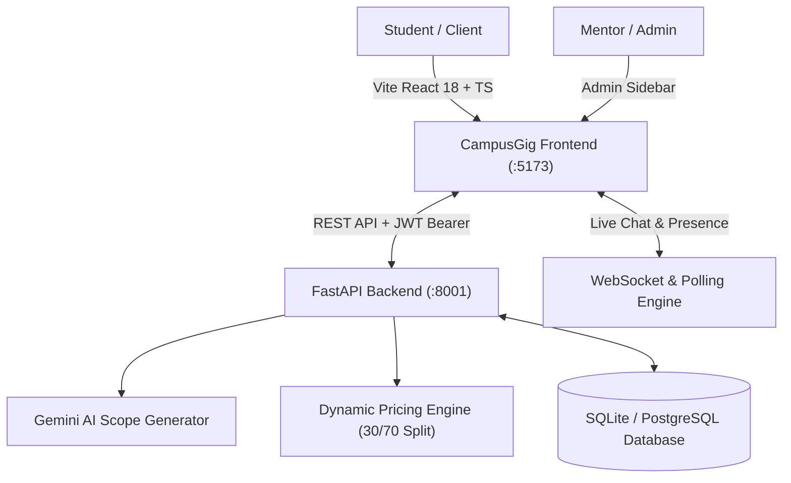

# CampusGig – Student Academic & Technical Freelance Marketplace Platform


-success?style=for-the-badge)

**CampusGig** is a full-stack freelance service marketplace and dedicated project workspace platform built specifically for academic projects (B.Tech, BCA, MCA, Diploma) and school assignments (Class 1 to 10th).

It enables the primary developer/mentor to offer tailored engineering projects, assignments, and mentorship courses with a dynamic milestone pricing model (**30% Advance to start work, 70% Balance on completion**), an **AI-powered project scope refiner**, and a **real-time 1-on-1 direct chat workspace with live online presence tracking**.

---

## 🌟 Key Functional Architecture

### 1. Dual-Portal Authentication (Student & Admin)
* **Student Portal:** Quick registration with academic profile (College Name, Branch or School Class, Phone, Email).
* **Admin / Mentor Portal:** Dedicated admin credentials (`admin` / `Admin@CampusGig2026`) unlocking complete control over orders, dynamic rate cards, student directories, deliverables, and course offerings.

---

### 2. Guided 4-Step Project Customizer Wizard (with `i.e.` Guidance)
* **Step 1: Stream & Domain Selection:**
  * **College / Degree Stream:** 8 technical domains (Machine Learning, Generative AI / RAG, Agentic AI, Full-Stack Web, Frontend, Backend APIs, Android / Mobile, Data Science & Analytics).
  * **School Stream (Class 1st to 10th):** Subject selector, class level, assignment type, and dynamic page-count slider.
* **Step 2: Guided Parameters & Add-ons:**
  * Contextual placeholders (e.g., *i.e., "Crop Recommendation System using Soil NPK values & Random Forest"*).
  * Feature requirement text with guided inputs.
  * Target submission deadline with delivery speed options (Normal, Express 48h, Super Express 24h).
  * Add-on deliverables with transparent price tags:
    * ✅ Source Code & Setup Guide (Included in Base)
    * 📄 Comprehensive Project Report (IEEE Format, 30-40 pages) -> `+ ₹500`
    * 📊 Presentation PPT Slides (15-20 animated slides) -> `+ ₹350`
    * 🎓 Viva & Exam Defense Preparation Guide (Top 30 Examiner Q&A) -> `+ ₹300`
    * 🎥 1-on-1 Code Walkthrough Call (Google Meet session) -> `+ ₹400`
* **Step 3: AI-Powered Scope Refiner & Prompt Customizer:**
  * Generates a structured Project Scope of Work (SOW): Refined Title, Planned Tech Stack badges, Deliverables checklist, Estimated timeline, and Methodology.
  * **Interactive Prompt Box:** Student can type requests (e.g., *"Add dark mode UI and include Random Forest evaluation metrics"*) and click **Update Scope** — the AI recalculates and regenerates the proposal instantly!
* **Step 4: 30% Advance Booking & UTR Submission:**
  * Clear transparent cost breakdown:
    $$\text{Total Cost} = \text{Base Price} + \text{Add-ons} + \text{Urgency Fee}$$
    $$\text{Advance Due Now (30%)} = 0.30 \times \text{Total Cost}$$
    $$\text{Balance on Completion (70%)} = 0.70 \times \text{Total Cost}$$
  * Displays Instant UPI QR & UPI ID (`mentor.campusgig@okhdfcbank`).
  * Student enters their 12-digit UPI UTR reference number to lock their project slot.

---

### 3. Dedicated 1-on-1 Live Chat Workspace
* Persistent chat room for every active order.
* **Live Online Presence:** Shows 🟢 **"Mentor is Online"** (with pulsing badge) when active on the platform.
* Multi-file attachment sharing (screenshots, reference PDFs, draft previews).
* Real-time polling with WebSocket fallback.
* Milestone progress strip at the top showing current status, advance paid, and remaining balance.

---

### 4. Milestone Completion & 70% Balance Release
* When the project is ready, Admin uploads demo screenshots or preview videos and flags status as `ready_for_review`.
* Student reviews the preview and submits remaining 70% balance.
* System marks order `completed` and unlocks direct download of final project artifacts (ZIP source code, Report PDF, PPT slides).

---

### 5. Admin Control Center & Dynamic Pricing Engine
* **Order Pipeline:** Filter orders by status (*Pending Advance, Advance Paid, In Progress, Ready for Review, Completed*).
* **Dynamic Pricing Engine:** Admin can update base prices and add-on rates across all 11 technical categories directly from the UI without touching code.
* **Student Directory:** View registered students, contact info, total orders placed, and lifetime spend.
* **Course Catalog Manager:** Publish self-paced masterclasses or 1-on-1 mentorship programs with pricing and syllabus.

---

## 👥 Default Credentials

| Portal / Role | Username | Password | Access Details |
| :--- | :--- | :--- | :--- |
| **Admin / Mentor** | `admin` | `Admin@CampusGig2026` | Full admin privileges: Pricing, Orders pipeline, Deliverable uploads, Student directory |
| **Sample Student** | `ananya_cse` | `Student@2026` | College student (BITS Pilani, CSE) with active project orders |

*(New students can also register instantly via the Landing Page modal)*

---

## 🚀 Live Development Server URLs

| Component | Port | URL | Description |
| :--- | :--- | :--- | :--- |
| **Frontend Web App** | `5173` | [http://127.0.0.1:5173](http://127.0.0.1:5173) | React 18 + TypeScript + Tailwind CSS |
| **Backend REST API** | `8001` | [http://127.0.0.1:8001](http://127.0.0.1:8001) | FastAPI + Python 3.12 |
| **Interactive Docs** | `8001` | [http://127.0.0.1:8001/docs](http://127.0.0.1:8001/docs) | OpenAPI / Swagger UI |

---

## 🧪 Automated Verification Test Suite (16/16 Passed)

To verify the complete backend and frontend API workflow, run:

```powershell
cd "D:\sem 7\campusgig"
python verify_campusgig.py
```

Or double-click [run_tests.bat](file:///d:/sem%207/campusgig/run_tests.bat).

### Test Suite Output:
```text
======================================================================
CAMPUSGIG E2E INTEGRATION & WORKFLOW VERIFICATION TEST SUITE
======================================================================
✅ PASS | TEST 1: Backend API Health Check (healthy)
✅ PASS | TEST 2: Admin Logged In successfully (Role: admin)
✅ PASS | TEST 3: Student Logged In (Ananya Mukherjee - BITS Pilani)
✅ PASS | TEST 4: Price Calculation: Base ₹1600.0 + Addons ₹850.0 = Total ₹2450.0 (30% Adv: ₹735.0, 70% Bal: ₹1715.0)
✅ PASS | TEST 5: AI Scope Proposal Generated: 'Crop Recommendation System using Soil NPK values - Machine Learning Project' with Tech: ['Python', 'Scikit-learn', 'Pandas']
✅ PASS | TEST 6: Project Order #CG-2026-00003 created successfully!
✅ PASS | TEST 7: 30% Advance Payment Verified (Status: advance_paid)
✅ PASS | TEST 8: Student Message sent to Workspace: 'Hi Mentor! I have paid the 30% advance. Can we add a dark mode theme to the dashboard?'
✅ PASS | TEST 9: Mentor Replied in Live Workspace: 'Hello Ananya! Advance confirmed. Yes, dark mode and Random Forest accuracy charts are added!'
✅ PASS | TEST 10: Chat History synced (2 live messages recorded)
✅ PASS | TEST 11: Admin updated order to 'ready_for_review'
✅ PASS | TEST 12: 70% Balance Paid (Status: completed - 100% Unlocked)
✅ PASS | TEST 13: Admin Dashboard Stats: Total Orders=3, Total Revenue=₹7250.0
✅ PASS | TEST 14: Admin modified ML Base Price dynamically in DB
✅ PASS | TEST 15: Student Directory returned 2 registered students
✅ PASS | TEST 16: Courses catalog endpoint verified
======================================================================
🏆 ALL 16 COMPREHENSIVE CAMPUSGIG PRODUCTION TESTS PASSED PERFECTLY!
======================================================================
```

---

## 🛠️ Technology Stack



* **Frontend:** React 18, TypeScript, Tailwind CSS, Lucide-React icons, Recharts, Axios, React Router v6.
* **Backend:** FastAPI (Python 3.12), SQLAlchemy 2.0 ORM, Pydantic v2, Python-Jose (JWT), pure bcrypt.
* **Real-time:** WebSockets with polling fallback for direct chat and online presence indicators.
* **AI:** Google GenAI / Gemini API with intelligent domain-specific fallback generators.
